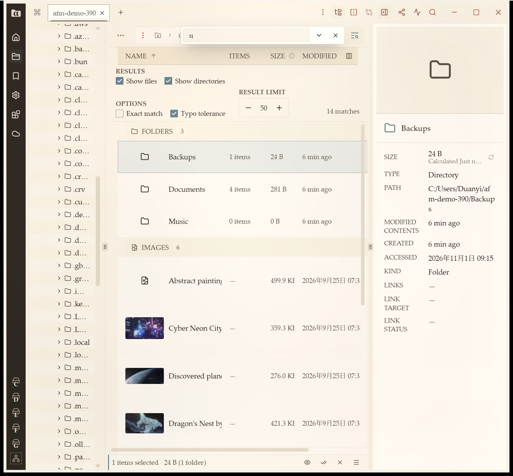
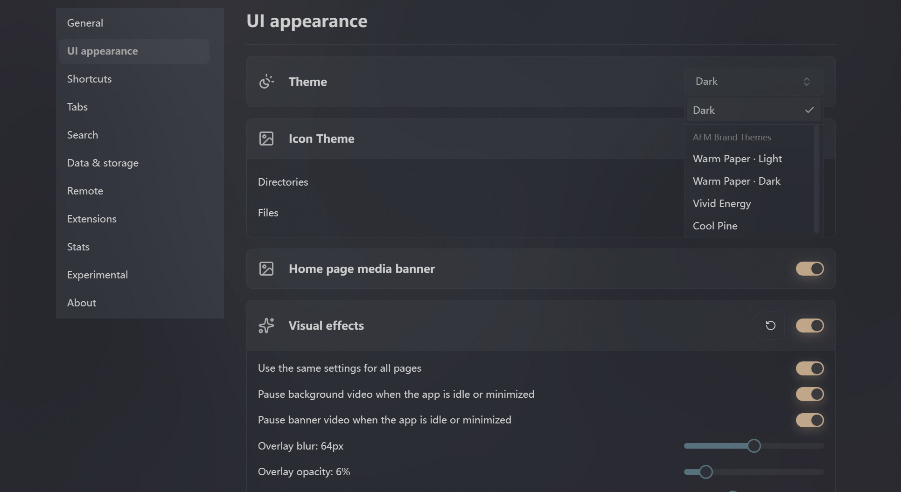
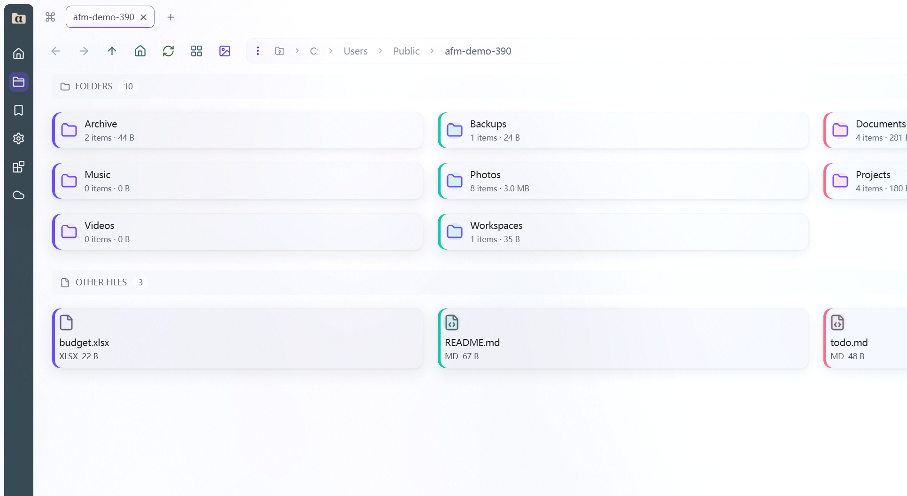
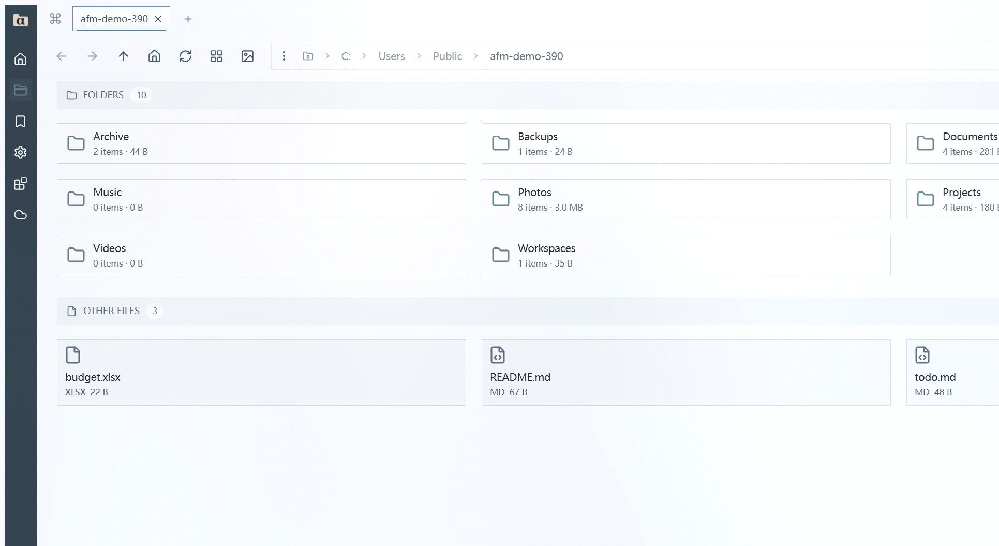
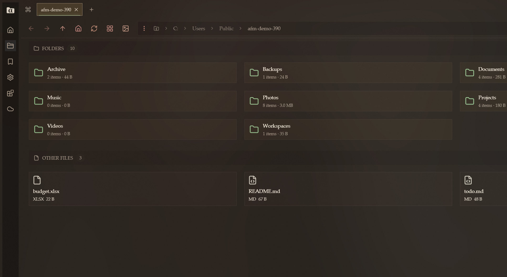
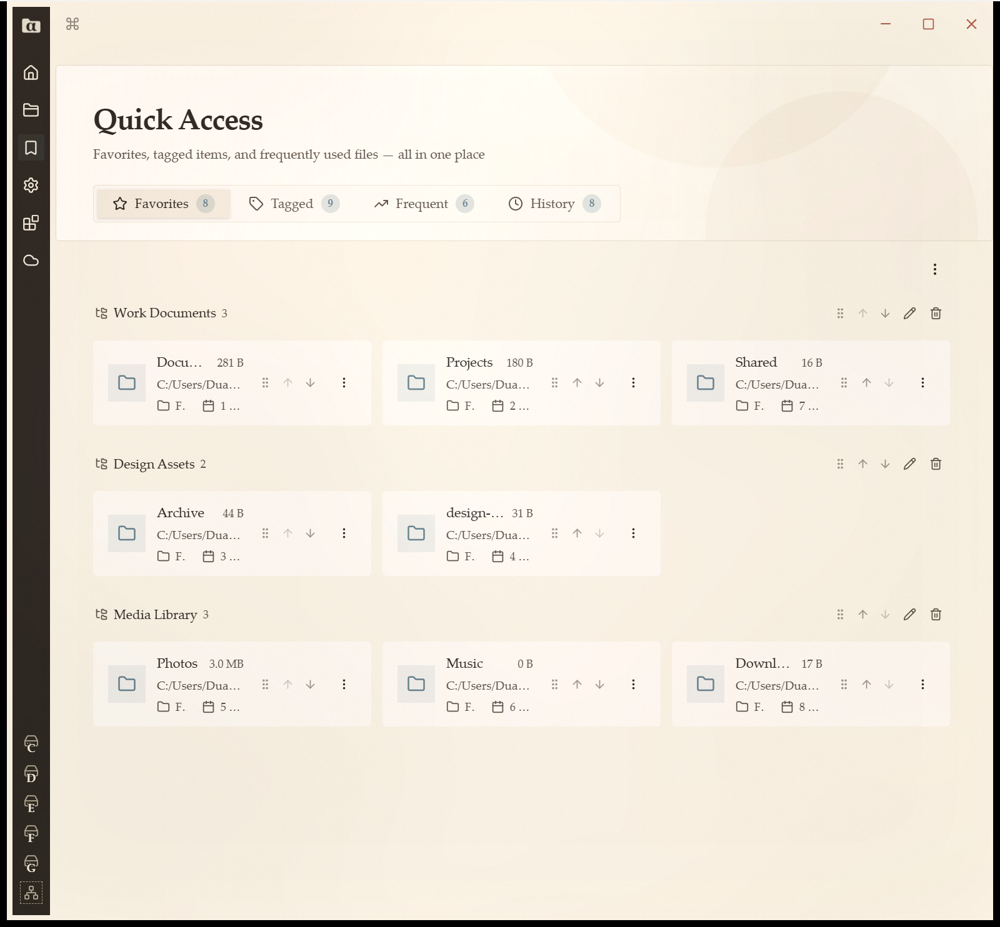
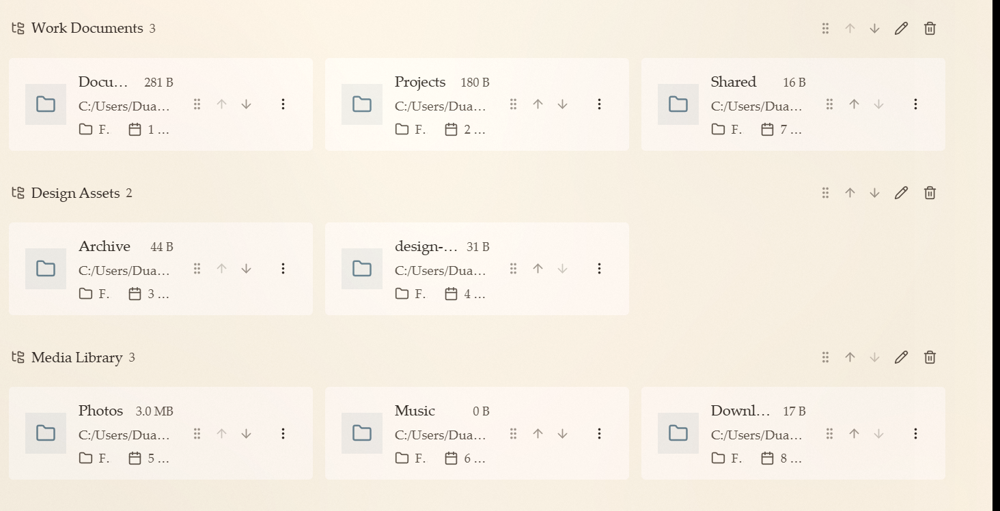

<!-- markdownlint-disable MD033 MD041 -->

**[English](README.md)** | **[中文](README.zh-CN.md)**

[](https://github.com/kizemo/alpha-file-manager/stargazers)
[](https://github.com/kizemo/alpha-file-manager/network/members)
[](https://github.com/kizemo/alpha-file-manager/issues)
[](https://github.com/kizemo/alpha-file-manager/releases/latest)
[](https://github.com/kizemo/alpha-file-manager/releases)
[](./LICENSE.md)
[](https://github.com/kizemo/alpha-file-manager/releases)

<h1>
  
  &nbsp;&nbsp;Alpha File Manager
</h1>

**A modern file manager for Windows and Linux — with the two things you miss most
in Explorer: a real folder tree, and file dialogs that follow you between apps.**



Alpha File Manager is an independent build of
[Sigma File Manager](https://github.com/aleksey-hoffman/sigma-file-manager),
maintained by [kizemo](https://github.com/kizemo). It tracks upstream and layers on
a permanent folder tree, cross-app dialog path sync, a built-in MCP server for AI
assistants, remote servers over SFTP/FTP/FTPS, recursive folder comparison with
sync, batch rename, and a long list of day-to-day fixes.

> [!IMPORTANT]
> **Alpha File Manager is an independent community project.** It is not affiliated
> with, endorsed by, or supported by the Sigma File Manager project. The base
> application's features and branding belong to [Aleksey Hoffman](https://github.com/aleksey-hoffman).

---

## ✨ Highlights

- 🗂️ **A folder tree that is always there** — it follows the pane you are in, local
  or remote, and it is the first thing you reach for instead of typing a path.
- ⚡ **Focus Sync** — every *Save As* / *Open* dialog in any other Windows app
  opens in the folder you are browsing. Zero configuration.
- 🔍 **Compare two folders, then sync what you find** — recursive, with the
  criteria serious tools use, and an explicit "direction undecided" state instead
  of guessing which side is newer.
- 🤖 **A built-in MCP server** — let an AI assistant list drives, browse folders,
  search files and read your favourites over a standard interface.
- 🔐 **Real remote servers** — SFTP, FTP and FTPS with pinned host keys and
  certificates, plus upload, download, delete and permission editing.
- 🧠 **Batch rename that does not lose work** — find-and-replace, case conversion,
  templates and numbering, with a live preview, conflicts blocked instead of
  silently overwriting, and undo.
- 🔓 **A file that will not delete can be dealt with** — the right-click menu tells
  you which program is holding it open, and *Delete anyway* removes it even when
  Windows refuses to.

---

## 🧭 Features

### Browse and organise

| | |
|---|---|
| 🗂️ | **Permanent folder tree** — follows the active pane, becomes the remote tree, remembers its own expansion state |
| 🗂️ | **Tabs and split view** — swap the two panes with one button, and a synchronized-browsing toggle right beside it |
| 🔎 | **Smart global search** — full-drive search with typo tolerance, and directory search that genuinely recurses |
| 🏷️ | **Tags** — organise files and folders, with a grouped, editable dashboard |
| ⭐ | **Favourites by category** — adding one asks which category it belongs to; categories are editable |
| 🎚️ | **Item filter** — narrow a large folder by name, size, date, type and more |
| 🖼️ | **Thumbnails** — four sizes, generated lazily only for what is on screen |
| 📐 | **Per-folder layout** — list or grid, chosen per location rather than globally |
| 🔓 | **Unlock a file that is in use** — the right-click menu lists the programs holding it, by name and process id; *Delete anyway* removes it even when Windows says no |

### Compare and sync

| | |
|---|---|
| 🔍 | **Recursive comparison** — modification time first, then size, then content checksum, in WinSCP's order |
| 🧭 | **"Direction undecided"** — same timestamp, different contents: listed separately, never overwritten |
| 📋 | **The plan comes first** — a preview of every file that would be created, copied or skipped, before the first byte moves |
| 🗑️ | **Compare and sync never deletes** — mirroring is a later release |

### Work on remote servers

| | |
|---|---|
| 🔐 | **SFTP · FTP · FTPS** — host keys and X.509 certificates pinned per host and port |
| ⬆️⬇️ | **Upload and download** — the receiving pane refreshes itself when the transfer finishes |
| 🗑️ | **Delete, honestly** — one *Delete* entry, no pretend recycle bin, the server's refusal reported as it is |
| 🔐 | **Permissions from a list** — pick the mode instead of typing the octal |
| 🌐 | **Map a network drive** — pick the share and the drive letter, like Explorer does |

### Automation and AI assistants

| | |
|---|---|
| 🤖 | **Built-in MCP server** — six read-only tools: drives, directory listing, search, size, favourites, mountable devices |
| ⚡ | **One-click setup for six assistants** — Codex, Cursor, Claude Code, Claude Desktop, OpenClaw, MiniMax Code |
| 🔒 | **Hardened by default** — localhost only, a random access key, and per-call permission checks |
| 🔌 | **Extensions and a marketplace** — extensions can add commands, pages, shortcuts and settings |
| ⌨️ | **Shortcuts and a command palette** — most actions are reachable from the keyboard |

### Look and feel

| | |
|---|---|
| 🎨 | **Background effects** — custom images and videos, with Photoshop-style blend modes |
| 🌈 | **Multiple beautified custom themes** — switch freely between Vivid Energy, Cool Pine, Warm Paper · Light / Dark and more |
| 🖼️ | **Quick view** — preview images, video, audio, PDFs and text with `Space`, without leaving the app |
| 📦 | **Zip archives** — compress and extract without leaving the app |
| 🪟 | **Can replace Explorer** — register as the default file manager on Windows |

| | |
|---|---|
|  | **Theme picker** — open the theme dropdown in Settings → UI appearance and see every bundled theme at once |
|  | **Vivid Energy** — vivid accents on a light canvas |
|  | **Cool Pine** — a cool green take on the light theme |
|  | **Warm Paper · Dark** — the paper theme turned down for the night |

---

## 📸 Screenshots

| | |
|---|---|
|  | **Quick Access** — favourites grouped by category, with thumbnails, sizes and relative times |
|  | **Dashboard cards** — name, size and path on top, type and item count below, with drag, reorder and edit shortcuts on every card |

### What changed in 3.13.4

| | | |
|---|---|---|
| 🔑 | **Baidu Netdisk signs in inside the app** — *Use the embedded window to sign in* opens the real Baidu login page in a built-in browser window; scanning the QR code there is enough, the session is picked up automatically and no cookie has to be copied by hand |
| 🛡️ | **A stale session is no longer taken for a fresh sign-in** — each attempt starts from a clean cookie jar, a sign-in that hands back the same session as the one before is refused, and a session the server already treats as signed out is rejected instead of being stored |
| 🚫 | **Saving without a signed-in session is refused** — the form points at *Sign in inside the app* instead of saving an entry that answers every request as signed out, and a sign-in that ends badly (window closed, timed out, session unreadable) now raises a toast instead of leaving one grey line of text |
| 🩺 | ***Test connection* tells the truth** — with no stored credential it no longer claims the password was refused, and the backend's own message appears under the outcome, so a timeout, an expired session and a refused credential no longer read alike |
| ⚡ | **Deleting a remote entry updates the listing at once** — the entries are removed from the listing before the refresh runs, so the change is visible without pressing *Refresh* |
| 📁 | **Creating a folder on Baidu Netdisk works** — the request used to carry every parameter in the query string with an empty body, which the server answered with a protocol error; it now sends a proper form body, and the new folder is created on the drive itself |
| 🐛 | **A failed remote *New folder* no longer leaves the dialog stuck** — the *Create* button is re-enabled when the operation fails and the dialog stays open for another attempt |
| 📝 | **Remote operations leave traces in the log** — *List*, *Delete* and *Create folder* each log a begin/done pair with the connection, the path, the entry count and the elapsed time |

### What changed in 3.13.0

| | |
|---|---|
| ☁ | **Baidu Netdisk is browsable as a remote connection** — add it from the cloud icon, give it the cookie of a signed-in session, and listing, creating a folder, renaming, deleting and downloading all reach the drive itself; no host or port is asked for, the host is fixed to `pan.baidu.com` and the agent is always direct |
| ⚙ | **Settings separates net disks from remote connections** — the *Remote* page is split into *Net disk* and *Remote connection* tabs, the add-connection page opens on the net disk tab, and *Trusted hosts* shows only where it applies |
| 🏠 | **The dashboard lists your connections** — the *Net disk & remote connections* card lists the servers you have saved by name and opens one in the navigator, instead of only offering a way to the settings page |
| 📍 | **The *Locations* page groups what you can reach** — volumes first, then net disks, then remote connections; a group with nothing in it shows no heading at all |
| 🐛 | **The navigator no longer stalls during a global search** — the search submission's disk I/O no longer holds the state write lock, so the window keeps responding while a scan runs |

### What changed in 3.12.2

| | |
|---|---|
| 🔗 | **Revealing a shortcut opens the target's folder** — *Open file location* on a `.lnk` now lands in the folder its target really lives in, with the target selected; a shortcut whose target is gone quietly falls back to the folder the `.lnk` sits in |
| 🛡️ | **The three system dialogs are gone** — *The operation has been aborted*, *The renderer process crashed (window main)* and *Windows can't find the `\` file* no longer interrupt the action, and the work now runs off the main thread instead of freezing the window |
| 🎨 | **Visual effects defaults match the specification** — overlay blur 0px, overlay opacity 0% and overlay noise 0% (were 64px/32px, 5% and 5%); *Reset visual effects to defaults* and fresh installs get these values, existing installations are not migrated automatically |

### What changed in 3.12.1

| | |
|---|---|
| 🖼️ | **A shortcut's icon no longer depends on your icon settings** — a `.lnk` shows its target's own icon whether the list is drawn from system icons or from the icon theme; a shortcut with a missing target still falls back to the generic one |
| 🪟 | **The address bar you type into shows `\` too** — the editor and the suggestions under it were still showing `/` after 3.12.0; they now match the rest of the app, while the internal path spelling stays single |
| 💾 | **Focus Sync follows *Save as* again** — the installer now carries 0.5.18 of the background component, which no longer loses the folder in a save dialog or in a localized one such as *Downloads* |

### What changed in 3.12.0

| | |
|---|---|
| 🪟 | **Paths are written the way Windows writes them** — every path you see, and every path you copy, now comes with `\` separators instead of `/`: the address bar, the breadcrumb, *Copy path*, the properties panel, a search result, a tab |
| 🔗 | **Paste a shortcut from the right-click menu** — copy a file or a folder, right-click a folder and pick *Paste shortcut*: the clipboard content lands there as a `.lnk` shortcut instead of a copy, and the clipboard stays put so you can paste it into more than one folder |
| 🖼️ | **A shortcut shows the icon of what it points at** — a `.lnk` to an executable wears that program's own icon in the file list; a shortcut whose target is gone falls back to the generic shortcut icon |

### What changed in 3.11.0

| | |
|---|---|
| 🔄 | **Turn and flip a picture from the right-click menu** — *Rotate left*, *Rotate right*, *Flip horizontally* and *Flip vertically* appear for a picture file; the edit is written back to the same file at once, with no dialog, no *Save as* and no second confirmation |
| 📌 | **A taskbar icon you pinned survives an update** — installing over an existing version hands the program over instead of cleaning up, so the pinned icon, the Start Menu shortcut and the autostart entry all stay where they were |
| 🔎 | **The global search results have their right-click menu again** — right-clicking a result opens the menu as before, and *Open the containing folder* jumps to the folder that holds the file and selects it there |
| ⚡ | **Turning a picture no longer takes the application down, and it is much faster** — the edit runs on a background thread, so the window stays responsive instead of the built-in watchdog shutting the program down and starting it again; encoding a large picture dropped from about 5.6 seconds to about 2.1 seconds |

### What changed in 3.9.0

| | |
|---|---|
| 🎨 | **The application icon was redrawn** — the whole set of glyphs was scaled up and the characters moved down, so the mark reads as a solid shape at task bar and installer sizes. Two colourways of it: a dark folder with a pale alpha on light backgrounds, a pale folder with a dark alpha on dark backgrounds. The settings header follows the theme; the installer and the task bar use the dark-background colourway |
| 🔴 | **Two icons at the top right of the navigator wear a low-saturation red** — the split view and folder tree buttons in the *Warm Paper* themes were a bright red that did not sit well on the paper |
| 🌍 | **The folder tree tooltip is now translated** — *Show folder tree* and *Hide folder tree* used to be English in every language; all seventeen language packs now carry them |
| 🔤 | **Three font sizes** — *Default*, *Large* and *Extra large*, each a fixed step of 0, 2 and 4 pixels on top of the current size, with the line heights and the properties panel following along |
| 📄 | **The settings page has an *About* page** — the logo, the name, the version that is running, and links out to the changelog, the project page, the commits and the issue tracker |
| ↕️ | **Favourites can be put in order** — drag the categories and the favourites in them into place, and the order is kept between restarts |

---

## ⚖️ Alpha File Manager vs Sigma File Manager vs Windows Explorer

Three different tools, three different jobs. Here is the honest version of how
they compare.

| | | Alpha File Manager | Sigma File Manager | Windows Explorer |
|---|---|---|---|---|
| 🖥️ | **Where it runs** | Windows + Linux | Windows + Linux | Windows only |
| 🌲 | **Folder tree in the left sidebar** | ✅ a permanent tree that follows the pane you are in — and becomes the remote tree | ➖ none | ✅ in the navigation pane |
| ⭐ | **Getting to the folders you use daily** | ✅ favourites grouped by category and editable — adding one asks which category it belongs to, so your working set is one click away | ➖ no categories, and adding one never asks | ➖ pinned to Quick access, no categories |
| ⚡ | **File dialogs in other apps** | ✅ **Focus Sync** — every dialog opens in the folder you are browsing | ➖ | ❌ |
| 🤖 | **Driven by an AI assistant** | ✅ built-in MCP server, one-click setup for six assistants | ❌ | ❌ |
| 🔐 | **Remote servers** | ✅ SFTP · FTP · FTPS, host keys and certificates pinned | ❌ | ➖ SMB / WebDAV / OneDrive, and no SFTP at all |
| 📤 | **Working on remote files** | ✅ upload, download, delete, set permissions | ❌ | ➖ shares only |
| ↔️ | **Two panes, used together** | ✅ **swap them with one button**, and a **synchronized browsing** toggle right beside it — enter a folder and the other pane follows, going up a level takes it along too | ➖ **no pane swap**; linked browsing exists but is a buried option in the navigator menu | ➖ tabs, not panes |
| 🔍 | **Comparing two folders** | ✅ recursively, with the criteria serious tools use — and an explicit "direction undecided" state instead of guessing which side is newer | ➖ | ➖ compares by size and date only, and the choice is buried |
| 🧠 | **Batch rename** | ✅ find-and-replace, case conversion, templates and numbering — with a live preview, conflicts blocked instead of silently overwriting, and undo | ❌ not in Sigma at all | ✅ find-and-replace, with a preview |
| 🔓 | **A file that will not delete** | ✅ the right-click menu lists the programs holding it, and *Delete anyway* removes it anyway — clearing the read-only flag, marking it for deletion, or falling back to deletion at the next restart | ➖ | ❌ |
| 🫳 | **Dragging a file into another program** | ✅ **hold the file and drag** it into WeChat, DingTalk or a browser — the window you are dragging out of stays in the background | ➖ | ✅ |
| 👁️ | **The program you drag over comes to the front** | ✅ the window under the pointer is brought forward while you carry the file, so you can see where it will land | ➖ | ➖ a Windows drag never raises the window under the pointer |
| ⌨️ | **Keyboard range selection** | ✅ **Shift + arrow key** extends the selection from the anchor you started at | ➖ | ✅ Shift + arrow key extends the selection too |
| 📊 | **Which columns to show** | ✅ chosen per location — the drives page drops the columns that have nothing to say | ➖ one set for every folder | ➖ one set for every folder |
| 💾 | **How full a drive is** | ✅ filled on the card, plus a Free space column | ➖ | ✅ |
| 🖼️ | **Thumbnail size** | ✅ four sizes | ➖ | ➖ the system size |
| 🌐 | **Mapping a network drive** | ✅ from the sidebar, with a drive letter you pick | ➖ | ✅ |
| 🎨 | **Background effects can blend** | ✅ the full set of Photoshop layer modes, with your own fill colour | ➖ | ❌ |

✅ has it · ➖ not part of that project · ❌ cannot

> **If you want the file manager that is part of Windows** — with the shell
> extensions, the codecs, the network shares, the EFS encryption and the "it
> works with everything" factor — use Explorer. No third-party file manager
> replaces that, and we are not going to pretend otherwise.
>
> **If you want one window in which a local disk and a remote server sit side by
> side**, with an assistant able to read your drives over a standard interface
> and a tree that follows you into either of them — that is what Alpha File
> Manager is. Explorer ships no SFTP client at all, and no way to let an
> assistant see your files without a third-party bridge.
>
> **Sigma File Manager** is the base application we build on. Take it if you
> want the upstream project itself, its own release cadence and its community.
> Alpha File Manager is an independent fork of it and tracks upstream.

---

## 📦 Download & install

**Primary download:** [**www.aiec.fun/alpha-file-manager**](https://www.aiec.fun/alpha-file-manager/)
— this is the update channel the app itself checks.

| | Platform | How |
|---|---|---|
| 🪟 | **Windows** | One-step installer from [the download page](https://www.aiec.fun/alpha-file-manager/) — installs, upgrades in place, and uninstalls cleanly |
| 🪟 | **Windows, portable** | The same installer works as a per-user install; the app never needs elevation |
| 🐧 | **Linux** | Builds are produced from source (`.deb` / `.AppImage`); see [build from source](#-build-from-source) |

GitHub releases carry the same installer and act as a fallback mirror:
[releases/latest](https://github.com/kizemo/alpha-file-manager/releases/latest).

> **Windows builds are unsigned**, so SmartScreen reports *"Unknown publisher"* —
> click **More info → Run anyway**. Upgrading in place keeps your settings,
> extensions and window layout.

---

## 🆕 What's new in 3.8.0

### 🎨 The archival-paper look, refined again

**Improved.** The two *Warm Paper* themes were tuned a second time: the main area is brighter
and less saturated, all icons are drawn in one pale beige line art, folder icons carry a muted
green accent, the tabs you are not in are dimmed and given a pale beige-grey edge, the list
header sits on a deeper ground with a rule above and below it, and the icon rail on the left is
a deep ink colour with pale icons on it. In *Vivid* the toolbar buttons are coloured by the job
they do - split view, folder tree, details, compare, more, extensions, search, new, filter - and
the buttons at the left of the address bar each get a colour of their own. Every colour was
solved against the title bar of its theme, so no icon falls below the 3 : 1 that non-text
graphics have to keep.

### 📐 Tabs size themselves, rows tell themselves apart

**Improved.** A tab now takes only as much width as its title needs, up to a maximum, and a
title that is still too long is cut with an ellipsis. In the list view a folder row and a file
row no longer sit on the same ground - folders get a tint of their own - so a long list can be
read by shape instead of by reading every line.

### 🖼️ A new application icon, in the warm-paper palette

**Changed.** The icon comes in two colourways: a dark folder with a pale alpha on light
backgrounds, and a pale folder with a dark alpha on dark backgrounds. The settings header
follows the theme; the installer and the task bar use the dark-background colourway.

### 🛠️ The *Follow Path* extension works again

**Fixed.** The uninstall step of the installer disabled the scheduled task of the extension and
the install step only started it, which cannot succeed for a task that is disabled - the
extension stopped answering after every install and every update. The installer now enables the
task before it starts it, so the extension comes back on its own. Its install script also no
longer writes a garbled title into the extension list, because the dash in the title is now
built at runtime instead of being read with the code page of the system. If the extension still
does not answer after an update, restart the application once.

---

## 👥 Community

| | |
|---|---|
| 🌐 | **Website** — [www.aiec.fun/alpha-file-manager](https://www.aiec.fun/alpha-file-manager/) |
| 💬 | **Discussions** — [ask a question or share an idea](https://github.com/kizemo/alpha-file-manager/discussions) |
| 🐛 | **Issues** — [report a bug](https://github.com/kizemo/alpha-file-manager/issues) |
| 🧑‍💻 | **Contributing** — [CONTRIBUTING.md](CONTRIBUTING.md) |

> **If Alpha File Manager is useful to you, a star helps other people find it.**
> GitHub only shows a project to people who search for it or see it shared, and
> a star is the single cheapest way to make it visible to both.

---

## 💻 Build from source

Alpha File Manager is a [Tauri v2](https://v2.tauri.app/) application: a Rust
backend (`src-tauri/`) and a Vue 3 + TypeScript frontend (`src/`).

```bash
git clone https://github.com/kizemo/alpha-file-manager.git
cd alpha-file-manager
npm ci --ignore-scripts
npm run tauri:dev          # development
npm run check              # lint + type-check + tests
npm run tauri:build        # release build
```

See [CONTRIBUTING.md](CONTRIBUTING.md) for prerequisites and the full workflow.

---

## Credits

- **Upstream:** [aleksey-hoffman/sigma-file-manager](https://github.com/aleksey-hoffman/sigma-file-manager)
  by [Aleksey Hoffman](https://github.com/aleksey-hoffman). The base application,
  its features and its branding belong to upstream.
- **Focus Sync extension:** lives in THIS repository under
  [`extensions/kizemo.focus-sync/`](./extensions/kizemo.focus-sync/) —
  extension payload, sidecar source and the standalone installer. Released
  standalone installers are archived at
  [kizemo/focus-sync](https://github.com/kizemo/focus-sync).
- **Git Tools extension:** lives in THIS repository under
  [`extensions/kizemo.git/`](./extensions/kizemo.git/) and is published from
  [kizemo/sfm-git-extension](https://github.com/kizemo/sfm-git-extension). It is
  served to the application from our own registry,
  [kizemo/sfm-marketplace](https://github.com/kizemo/sfm-marketplace), which the
  market reads as the *Official* source, above the legacy Sigma registry shown as
  a *Third-party* source.
- **Publisher of our extensions:** [Alpha File Manager](https://github.com/kizemo/alpha-file-manager).
  Extensions we publish are badged *Official* next to their name and listed under
  *Featured* in the market.
- **Maintainer of this fork:** [kizemo](https://github.com/kizemo)

Additional code reused under its original terms:
[inaku-Gyan/PathWrap](https://github.com/inaku-Gyan/PathWrap) (MIT) ·
[QwenLM/qwen-code](https://github.com/QwenLM/qwen-code) (Apache-2.0).

---

## License

**GPL-3.0-or-later** — the full text is in [`LICENSE.md`](./LICENSE.md), and the
copyright notice plus a plain-language summary are in [`NOTICE.md`](./NOTICE.md).
Fork additions are contributed under the same license.

As required by GPL-3, the corresponding source for every shipped binary is
available at:

| Component | Source |
|---|---|
| Alpha File Manager (this fork) | <https://github.com/kizemo/alpha-file-manager> |
| Sigma File Manager (base) | <https://github.com/aleksey-hoffman/sigma-file-manager> |
| Focus Sync extension + sidecar | bundled in this repository, `extensions/kizemo.focus-sync/` |
| Git Tools extension | bundled in this repository, `extensions/kizemo.git/` |
