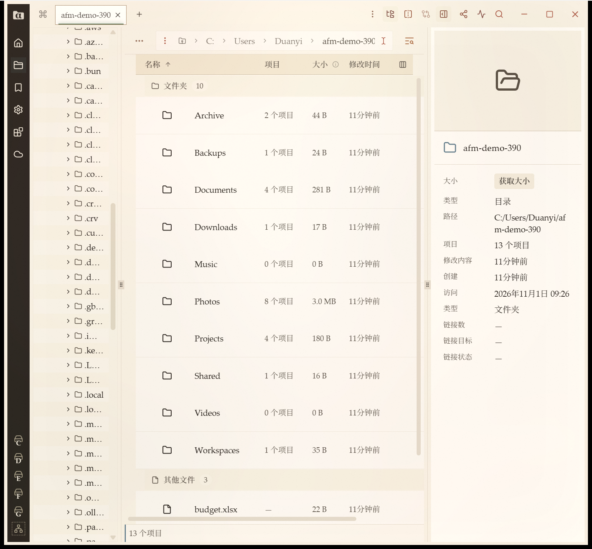
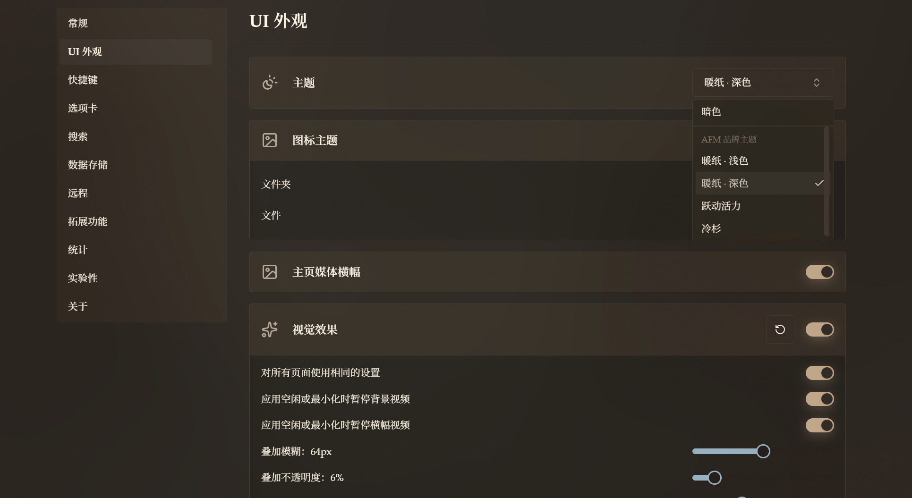
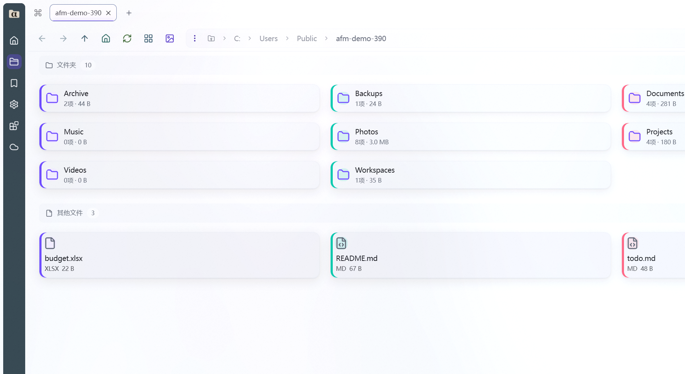
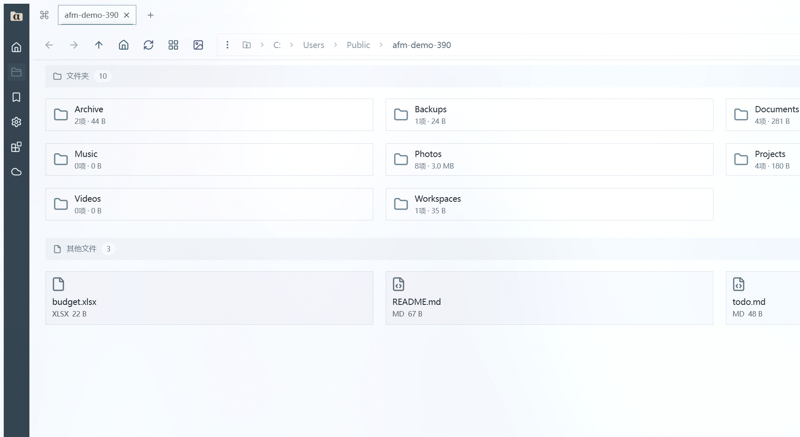
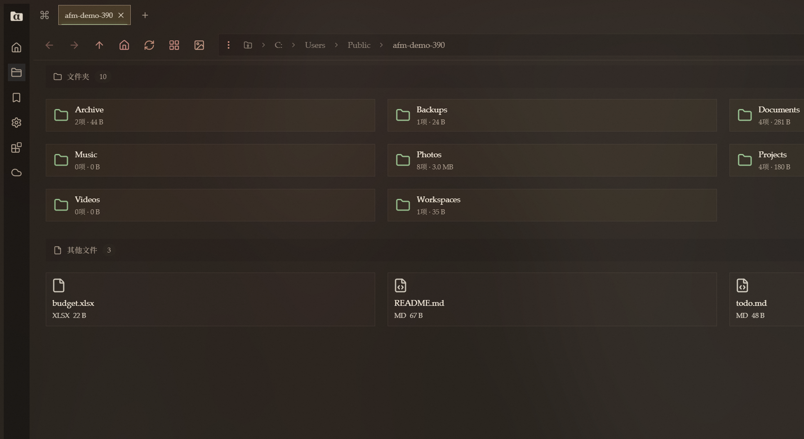
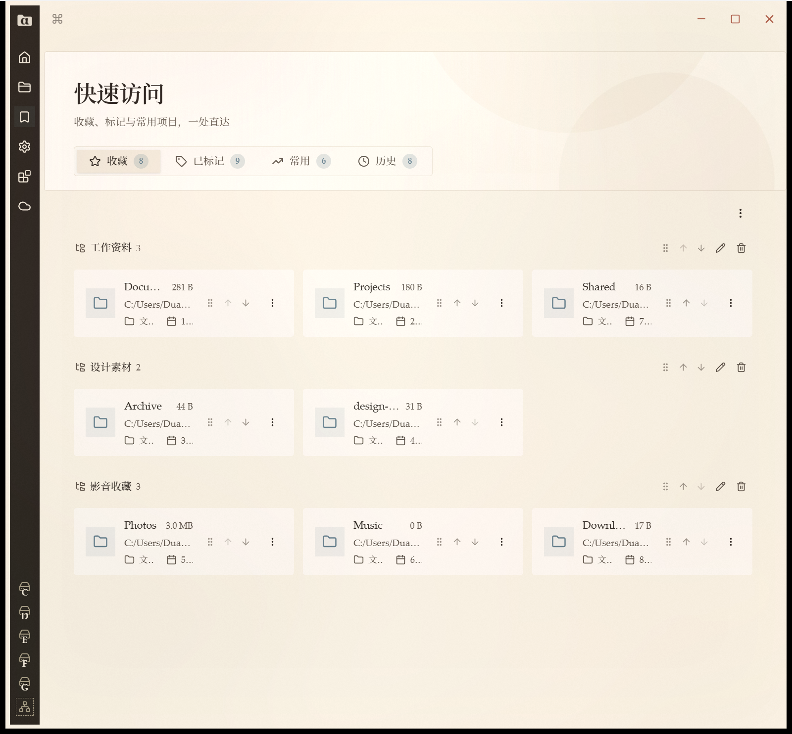
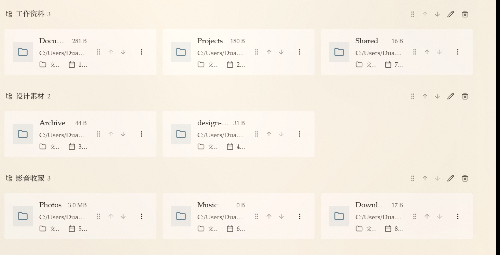

<!-- markdownlint-disable MD033 MD041 -->

**[English](README.md)** | **[中文](README.zh-CN.md)**

[](https://github.com/kizemo/alpha-file-manager/stargazers)
[](https://github.com/kizemo/alpha-file-manager/network/members)
[](https://github.com/kizemo/alpha-file-manager/issues)
[](https://github.com/kizemo/alpha-file-manager/releases/latest)
[](https://github.com/kizemo/alpha-file-manager/releases)
[](./LICENSE.md)
[](https://github.com/kizemo/alpha-file-manager/releases)

<h1>
  
  &nbsp;&nbsp;Alpha File Manager
</h1>

**最好用的资源管理器** —— 面向 Windows 与 Linux，补上 Windows 资源管理器最缺的两件事：
一棵真正的目录树，以及会跟着你跨应用走的文件对话框。**



Alpha File Manager 是 [Sigma File Manager](https://github.com/aleksey-hoffman/sigma-file-manager)
的独立衍生版本，由 [kizemo](https://github.com/kizemo) 维护。它跟随上游同步，并在其上叠加了
常驻目录树、跨应用的文件对话框路径同步、给 AI 助手用的内置 MCP 服务、
SFTP/FTP/FTPS 远程服务器、目录递归比较与同步、批量改名，以及一长串日常使用中的细节修复。 **如果你一直在找一个更好用的 Windows 资源管理器，Alpha File Manager 就是它。**

> [!IMPORTANT]
> **Alpha File Manager 是独立的社区项目**，与 Sigma File Manager 项目无隶属关系，
> 未获其认可或官方支持。基础应用的功能与品牌归
> [Aleksey Hoffman](https://github.com/aleksey-hoffman) 所有。

---

## ✨ 亮点

- 🗂️ **目录树一直在那儿** —— 跟着你正在用的那一格走，本地远程都一样，
  不用再手敲路径。
- ⚡ **Focus Sync** —— 任何 Windows 应用里的 *另存为* / *打开* 对话框，
  都开在你正在浏览的目录。零配置。
- 🔍 **并排比较两个目录，再按结果同步** —— 递归比较，准则跟专业工具同一套，
  并且有明确的「方向待定」，而不是猜哪边更新。
- 🤖 **内置 MCP 服务** —— 让 AI 助手用一套通用接口列盘符、浏览目录、搜索文件、读收藏。
- 🔐 **真正的远程服务器** —— SFTP、FTP、FTPS，主机密钥与证书固定，
  外加上传、下载、删除、改权限。
- ☁️ **网盘也是远程连接** —— 百度网盘、夸克网盘几步就能加进来，在应用内登录、
  扫码即可；浏览、建目录、下载都落在网盘本体上，阿里云盘、Google 云盘等
  主流网盘后续会接进来。
- 🧠 **批量改名不丢东西** —— 查找替换、大小写转换、模板与编号，
  带实时预览，冲突当场拦下而不是静默覆盖，还能撤销。

---

## 🧭 功能

### 浏览与整理

| | |
|---|---|
| 🗂️ | **常驻目录树** —— 跟着当前分栏走，远程时变成远程目录树，自己的展开状态也记得住 |
| 🗂️ | **标签页与分屏** —— 一个按钮左右互换，旁边还有「同步浏览」开关 |
| 🔎 | **智能全局搜索** —— 整盘搜索带拼写容错，目录内搜索是真的递归 |
| 🏷️ | **标记** —— 给文件与目录分组，仪表盘里分组展示且可编辑 |
| ⭐ | **收藏按分类** —— 添加时会问归到哪一类，分类可以改名、删除 |
| 🎚️ | **条目过滤** —— 按名称、大小、日期、类型等收窄一个大目录 |
| 🖼️ | **缩略图** —— 四档尺寸，只对视口内的内容按需生成 |
| 📐 | **按文件夹的布局** —— 列表还是网格，按位置决定，而不是全局一个开关 |

### 比较与同步

| | |
|---|---|
| 🔍 | **递归比较** —— 先看修改时间，再看大小，最后看内容校验和，与 WinSCP 同序 |
| 🧭 | **「方向待定」** —— 时间相同、内容不同：单独列出，绝不覆盖 |
| 📋 | **计划先于动手** —— 动手之前先给你看：每个会新建、复制、跳过的条目 |
| 🗑️ | **比较并同步永远不删东西** —— 带删除的镜像留到后面的版本 |

### 在远程服务器上干活

| | |
|---|---|
| 🔐 | **SFTP · FTP · FTPS** —— 主机密钥与 X.509 证书按主机与端口分别固定 |
| ⬆️⬇️ | **上传与下载** —— 传完之后，收到东西的那一格自己刷新 |
| 🗑️ | **删除,如实说** —— 只给一个「删除」，不给你假的回收箱，服务器拒绝就如实报 |
| 🔐 | **权限从列表里挑** —— 不用自己敲八进制 |
| 🌐 | **映射网络驱动器** —— 像资源管理器那样：挑共享、挑盘符 |

### 在网盘上干活

| | |
|---|---|
| ☁️ | **百度网盘在应用内登录** —— 点一下就打开真实的登录页，扫码即可，登录态自动回填并存进凭据库，不用手工拷 Cookie |
| 🔗 | **夸克网盘同样的用法** —— 在同一个「添加网盘」里选「夸克网盘」，应用内弹出登录窗口，扫码即可，登录态照样自动存好 |
| ➕ | **加一个网盘只要三步** —— 设置 → 远程 → 网盘 → 选网盘 → 扫码 → 起个名字。不用拷 Token、不用改配置文件、不用另起一个服务 |
| 📂 | **网盘当远程连接浏览** —— 列目录、新建文件夹、重命名、删除、下载，全部落到网盘本体上，不是本地文件夹的影子 |
| ⚙️ | **网盘与远程服务器分开管理** —— 设置页分成「网盘」与「远程连接」两个标签页，各归各类，不混在一起 |
| ➕ | **以后会接更多主流网盘** —— 阿里云盘、Google 云盘等都在计划里，走的是同一套远程连接机制 |

#### 为什么比用 alist 挂载到资源管理器更省事

把网盘挂进 Windows 资源管理器 —— 无论用 alist、rclone 还是 WebDAV 桥接 ——
都意味着为了看文件先跑起第二个程序：它要自己有容器或服务、自己一套数据库、
自己一份配置里粘 Token 或 refresh key，挂了还得手工重启。资源管理器再经 WebDAV
客户端去读这个盘，于是又叠上一层限制。

在这里加网盘，上面这些一概不需要：

| | 用 alist / WebDAV 挂载 | 在 Alpha File Manager 里加网盘 |
|---|---|---|
| 🧩 | **要多装并常驻一个软件** —— 服务进程、容器都可能自己倒下 | **什么都不用多装** —— 网盘能力就在应用里 |
| 🔑 | **凭据落在桥接程序里** —— Token、refresh key 要粘进别的程序的配置 | **凭据留在应用里** —— 扫码登录，登录态存在应用自己的加密凭据库 |
| 🪟 | **还得映射盘符或配 WebDAV 客户端** —— 限制也由那层客户端承担 | **完全不用映射** —— 网盘就是应用里的一格，目录树、列目录、传输都在 |
| 🛡️ | **桥接挂了就是盘没了** —— 服务不起来，盘就消失 | **中间没有任何第三方** —— 应用直接走网盘官方接口，没有会掉线、会限速的中间一跳 |
| 🔁 | **要跟着更新两样东西** —— 网盘接口一变，桥接程序就得跟着改 | **只要更新一样东西** —— 应用本身，且走它自己的更新通道 |

### 自动化与 AI 助手

| | |
|---|---|
| 🤖 | **内置 MCP 服务** —— 六个只读工具：盘符、目录列表、搜索、体积、收藏、可挂载设备 |
| ⚡ | **六家助手一键部署** —— Codex、Cursor、Claude Code、Claude Desktop、OpenClaw、Minimax Code |
| 🔒 | **默认就是加固的** —— 只监听本机、随机访问密钥、每次调用都重新检查权限 |
| 🔌 | **扩展与扩展市场** —— 扩展可以加命令、加页面、加快捷键、加设置项 |
| ⌨️ | **快捷键与命令面板** —— 大部分操作都能用键盘完成 |

### 外观与体验

| | |
|---|---|
| 🎨 | **背景视觉效果** —— 自定义图片与视频，支持 Photoshop 式混合模式 |
| 🌈 | **多种美化的自定义主题自由切换** —— 跃动活力、冷杉、暖纸 · 浅色 / 深色等主题随时切换 |
| 🖼️ | **快速查看** —— 按 `Space` 预览图片、视频、音频、PDF 与文本，不用离开应用 |
| 📦 | **Zip 压缩包** —— 压缩与解压都在应用内完成 |
| 🪟 | **可以接管资源管理器** —— 在 Windows 上注册为默认文件管理器 |

| | |
|---|---|
|  | **主题选择器** —— 在「设置 → UI 外观」点开主题下拉，一次看全所有内置主题 |
|  | **跃动活力** —— 浅色底上的高饱和强调色 |
|  | **冷杉** —— 偏冷绿调的浅色主题 |
|  | **暖纸 · 深色** —— 纸感主题的夜间版本 |

---

## 📸 界面

| | |
|---|---|
|  | **快速访问** —— 收藏按分类分组，带缩略图、大小与「X 小时前」 |
|  | **仪表板卡片** —— 上层是名称、大小与路径，下层是类型与条目数，每张卡片自带拖动、排序与编辑快捷操作 |

### 3.14.0 改了什么

| | | |
|---|---|---|
| ☁️ | **夸克网盘可以和百度网盘并列添加** —— 设置 → 远程 → 网盘 的「添加网盘」里现在同时提供两家；登录窗口在应用内弹出，登录态自动存好，存下来的连接和别的远程连接一样用 |
| 🔐 | **登录态不完整就不会被存下来** —— 下载直链需要的 Cookie 比登录页先给出的那个多一个；应用会等它到位再存，于是不会再出现「存好了、一下载就失败」 |
| 📋 | **从网盘目录里复制文件又可以了** —— 右键菜单里有「复制」，粘到本地文件夹就真的落地 |
| 📑 | **远程设置页直接从标签页开始** —— 原来压在「网盘」「远程连接」两个标签页上面的那段说明，搬进了标签页里 |

### 3.13.6 改了什么

| | | |
|---|---|---|
| ⌨️ | **地址栏补全不再无声变空** —— 后端偶尔会返回一份缺了条目列表的目录结果，地址栏直接对它调用 `.filter()` 就抛了错，而这条调用链是「发出去就不管」的，异常被吞掉：没有错误码、没有提示，用户只看到输入路径时建议列表一片空白。现在这种结果被当成「读取失败」，地址栏退回「列出当前目录」，建议照常给 |
| 🧩 | **Focus Sync 不会再「装了却毫无反应」** —— 应用会拒绝违反自身沙箱规则的扩展，而且是在扩展运行之前就拒绝：没有窗口、没有通知，功能等于不存在。原本用来拦这一下的检查在打包安装时被跳过了；现在每个打包产物在发布前都会被校验一遍 |

### 3.13.5 改了什么

| | | |
|---|---|---|
| 🔌 | **焦点同步助手不再开机自启** —— 它以前由一个 Windows 登录计划任务拉起，挂在后台占着端口、盯着各种对话框，即使 Alpha File Manager 没开也一样；现在由应用拉起、随应用一起结束，助手的存在时间与应用完全一致 |
| 🧹 | **升级时把旧的登录计划任务彻底清掉** —— 计划任务原先要等新助手部署成功之后才被删除，一旦部署失败它就会留在系统里，一分钟后还能把旧助手拉回来；现在它在动助手文件之前就被删除，并且安装器会等旧进程真正退出后再替换文件 |
| 📦 | **扩展的独立安装器也遵守同一条规则** —— 单独安装 Focus Sync 扩展不再重新注册那个已经退休的计划任务，改为把它清掉，并在部署新二进制之前先结束残留的助手进程 |

### 3.13.4 改了什么

| | | |
|---|---|---|
| 🔑 | **百度网盘在应用内登录** —— 「用内嵌窗口登录」会打开一个真实的百度登录页，扫码即可，登录态自动回填，不用手工拷贝 Cookie |
| 🛡️ | **旧会话不再被当成新登录** —— 每次登录都从干净的 Cookie 罐子开始；交回与上次相同会话的登录被判为无效，服务端已认定登出的会话直接拒收，不会被存下来 |
| 🚫 | **没有登录态时不允许保存** —— 表单会提示先在应用内登录，而不是把一个「每条请求都回答未登录」的连接存下来；登录窗口被关、超时、会话读不出来，现在都会弹 toast 提示，而不是留一行灰字 |
| 🩺 | **「测试连接」如实说话** —— 没有凭据时不再报「密码被拒绝」，后端自己的诊断信息会显示在结论下方，超时、会话过期、凭据被拒不再读起来一样 |
| ⚡ | **删除远程条目后列表立即更新** —— 条目在回读之前先从列表里去掉，不用按「刷新」才看得见 |
| 📁 | **百度网盘上新建目录成功了** —— 请求此前把参数全塞在 query、body 是空的，服务端回的是协议层错误；现在改为发真正的表单体，新建目录落到网盘本体 |
| 🐛 | **远程「新建目录」失败不再卡住对话框** —— 失败时「创建」按钮恢复可点，对话框留在原地可以再试一次 |
| 📝 | **远程操作留下日志** —— 列目录、删除、新建目录各记一对「开始 / 完成」，带连接、路径、条目数与耗时 |

### 3.13.0 改了什么

| | |
|---|---|
| ☁ | **百度网盘可以当远程连接浏览** —— 在侧边栏云图标里添加，填一个已登录会话的 Cookie，就能打开网盘自己的目录树：列出目录、新建文件夹、重命名、删除与下载都落到网盘本体上；不用填主机与端口，主机恒为 `pan.baidu.com`，代理恒为直连 |
| ⚙ | **设置页把网盘与远程连接分开** —— *设置 > 远程* 拆成「网盘」与「远程连接」两个选项卡，「添加连接」默认落在网盘页，「已信任的主机」只在用得到的地方显示 |
| 🏠 | **主页列出你已配置的连接** —— 主页的「网盘 与 远程连接」卡片按名字列出已配置的服务器，点一下就在导航器里打开，不再只是给一个去设置页的入口 |
| 📍 | **「位置」页分区了** —— 最上面是分区（盘符），然后是网盘，最后是远程连接；空的一组连标题都不显示 |
| 🐛 | **全局搜索进行中导航器不再卡住** —— 搜索提交的磁盘 I/O 不再占着状态写锁，扫描时窗口保持响应 |

### 3.12.2 改了什么

| | |
|---|---|
| 🔗 | **快捷方式「打开文件所在目录」落到目标所在目录** —— 右键 `.lnk` 选「打开文件所在目录」，现在打开的是目标真正所在的文件夹，并选中目标；目标已经不在的快捷方式安静地回落成打开 `.lnk` 自己所在的目录 |
| 🛡️ | **三个系统弹窗不再出现** —— 「已中止操作」「渲染进程已崩溃（窗口 main）」「Windows 找不到 `\` 文件」都不再打断操作，相关工作也改到后台线程执行，不再把窗口卡死 |
| 🎨 | **视觉效果默认参数改成规格值** —— 叠加模糊 0px、叠加不透明度 0%、叠加噪点 0%（原 64px/32px、5%、5%）；「重置为默认值」和新装软件都会拿到这组值，存量安装不会自动迁移 |

### 3.12.1 改了什么

| | |
|---|---|
| 🖼️ | **快捷方式的图标不再看图标设置的脸色** —— 不管文件列表用的是系统图标还是图标主题，`.lnk` 都显示目标自己的图标；目标已经不在的快捷方式仍退回通用图标 |
| 🪟 | **手动输入的地址栏也用 `\`** —— 3.12.0 之后编辑器本身和它下面的建议行还显示 `/`，现在与全应用一致，而内部只保持一种写法 |
| 💾 | **Focus Sync 重新跟得上「另存为」** —— 安装包内嵌的后台组件升到 0.5.18，不再在保存弹窗或「下载」这类本地化目录里丢失目标 |

### 3.12.0 改了什么

| | |
|---|---|
| 🪟 | **路径终于写成 Windows 自己的样子** —— 你看到的、你复制走的路径一律用 `\` 分隔，不再是 `/`：地址栏、面包屑、「复制路径」、信息面板、搜索结果、标签页都是 |
| 🔗 | **右键菜单里可以「粘贴快捷方式」** —— 复制文件或文件夹后，右键一个文件夹选「粘贴快捷方式」，剪贴板里的内容会以 `.lnk` 快捷方式落进去，而不是复制一份；剪贴板不清空，可以往多个文件夹里反复粘贴 |
| 🖼️ | **快捷方式显示目标的图标** —— 指向 exe 的 `.lnk` 在文件列表里用程序自己的图标；目标已经不在的快捷方式退回通用快捷方式图标 |

### 3.11.0 改了什么

| | |
|---|---|
| 🔄 | **右键菜单里可以旋转与翻转图片** —— 图片文件多出「向左旋转」「向右旋转」「左右翻转」「上下翻转」四项，改完直接写回原文件，不用对话框、不用另存、也没有第二次确认 |
| 📌 | **固定在任务栏的图标更新后不再消失** —— 覆盖安装改成交接而不是清理，固定图标、开始菜单快捷方式与开机自启项都留在原处；真要卸载时照旧清掉 |
| 🔎 | **全局搜索结果重新有了右键菜单** —— 右键结果照常弹菜单，「打开所在目录」跳到文件所在的文件夹并选中它 |
| ⚡ | **旋转图片不再把应用带崩，而且快了很多** —— 改图改到后台线程执行，窗口始终有响应，不会再被内置看门狗当成界面卡死而关掉重开；大图的编码耗时从约 5.6 秒降到约 2.1 秒 |

### 3.9.0 改了什么

| | |
|---|---|
| 🎨 | **应用图标重画** —— 整组字形做了仿射放大、字符下移，图标在任务栏与安装器的小尺寸下也读得出形状。两套配色：浅色背景用「深色文件夹 + 浅色 α」，深色背景用「浅米文件夹 + 深色 α」。设置页抬头跟随主题切换，安装器与任务栏用深色背景那一版 |
| 🔴 | **导航器右上角两枚图标换成低饱和度的红** —— *暖纸* 主题里的分屏与目录树按钮原本是亮红，放在纸面上很扎眼 |
| 🌍 | **目录树按钮的提示完成了翻译** —— 「显示目录树 / 隐藏目录树」过去无论什么语言都是英文，如今 17 个语言包都已补齐 |
| 🔤 | **字体大小三档** —— 「默认 / 大 / 特大」，分别在当前字号上增加 0 / 2 / 4 像素，行高与右侧属性栏同步适配 |
| 📄 | **设置页多了「关于」** —— 应用图标、名称、正在运行的版本号，以及更新日志、项目主页、提交记录、问题反馈的入口 |
| ↕️ | **收藏夹可以排序了** —— 分类与分类里的收藏项都能拖拽调整位置，顺序在重启后保留 |

---

## ⚖️ Alpha File Manager vs Sigma File Manager vs Windows 资源管理器

三样东西，三种活法。下面是它们之间**如实**的对比。

| | | Alpha File Manager | Sigma File Manager | Windows 资源管理器 |
|---|---|---|---|---|
| 🖥️ | **跑在哪** | Windows + Linux | Windows + Linux | 只有 Windows |
| 🌲 | **左侧目录树** | ✅ 常驻的一棵树，跟着你正在用的那一格走 —— 远程也能成树 | ➖ 没有 | ✅ 在导航窗格里 |
| ⭐ | **常用文件夹一键直达** | ✅ 收藏按分类分组、可以编辑，添加时还会问「归到哪一类」，常用集合一点就进 | ➖ 没有分类，添加时也不问 | ➖ 只能钉在「快速访问」，没有分类 |
| ⚡ | **别的应用里的文件对话框** | ✅ **Focus Sync** —— 任何对话框都开在你正在浏览的目录 | ➖ | ❌ |
| 🤖 | **让 AI 助手驱动它** | ✅ 内置 MCP 服务，六家助手一键部署 | ❌ | ❌ |
| 🔐 | **远程服务器** | ✅ SFTP · FTP · FTPS，主机密钥与证书固定 | ❌ | ➖ SMB / WebDAV / OneDrive，压根没有 SFTP |
| ☁️ | **网盘（云盘）** | ✅ **百度网盘、夸克网盘** —— 在应用里加进来、应用内登录，当作远程连接直接浏览；**阿里云盘、Google 云盘等主流网盘正在路上** | ❌ | ➖ 只有 OneDrive |
| 📤 | **在远程文件上干活** | ✅ 上传、下载、删除、改权限 | ❌ | ➖ 只有网络共享 |
| ↔️ | **两格并排着用** | ✅ **一个按钮左右互换**，旁边还有**「同步浏览」开关** —— 进入一个目录，另一格跟着走，往上退一级也带着它 | ➖ **没有左右互换**；联动分屏有，但埋在导航器的选项菜单里 | ➖ 是标签页，不是并排两格 |
| 🔍 | **比较两个目录** | ✅ 递归比较，准则跟专业工具同一套 —— 并且有明确的「方向待定」，而不是猜哪边更新 | ➖ | ➖ 只比大小与日期，选项藏得很深 |
| 🧠 | **批量改名** | ✅ 查找替换、大小写转换、模板与编号 —— 带实时预览，冲突当场拦下而不是静默覆盖，还能撤销 | ❌ Sigma 里根本没有这个功能 | ✅ 有查找替换，也带预览 |
| 🫳 | **把文件拖到别的程序里** | ✅ **按住文件就能拖出去** —— 微信、钉钉、浏览器都行，而且拖的那个窗口待在后台不抢前台 | ➖ | ✅ |
| 👁️ | **拖的时候目标程序提到前面** | ✅ 鼠标停在哪个应用上，哪个窗口就替你带到前面，落点一眼就看见 | ➖ | ➖ Windows 的拖拽不会把目标窗口提到前面 |
| ⌨️ | **键盘连选** | ✅ **Shift + 方向键**从你起手的锚点往外扩选 | ➖ | ✅ Shift + 方向键也能扩选 |
| 📊 | **显示哪些列** | ✅ 按位置决定 —— 「位置」页会去掉那些根本没话说的列 | ➖ 所有目录一套列 | ➖ 所有目录一套列 |
| 💾 | **盘用了多少** | ✅ 卡片上直接填充，还有一列「可用空间」 | ➖ | ✅ |
| 🖼️ | **缩略图尺寸** | ✅ 四档可选 | ➖ | ➖ 跟随系统 |
| 🌐 | **映射网络驱动器** | ✅ 从侧边栏就能做，盘符自己挑 | ➖ | ✅ |
| 🎨 | **背景效果支持混合模式** | ✅ Photoshop 的图层模式全套，还能配自己的填充色 | ➖ | ❌ |

✅ 有 · ➖ 这个项目里没有 · ❌ 做不到

> **网盘这一块我们会一直做下去。** 现在跑通的是百度网盘与夸克网盘 —— 在应用里加一个、
> 应用内登录，当作远程连接浏览，列目录、新建文件夹、下载都落在网盘本体上。阿里云盘、
> Google 云盘等主流网盘会陆续接进来，走的是同一套远程连接机制：侧栏里挂一个连接，
> 目录树、列目录、上传下载都跟着走。

> **你想要的是「Windows 自带的那个」** —— 要 Shell 扩展、要编解码器、要网络共享、要 EFS 加密，
> 还要那种「跟什么都能对上」的踏实感，那就用资源管理器。任何第三方文件管理器都替代不了这一点，
> 我们也不会假装可以。
>
> **你想要的是「一个窗口里，本地磁盘和远程服务器并排待着」** —— 助手还能通过一套通用接口读你的盘，
> 目录树能跟着你走进其中任何一边，这就是 Alpha File Manager。资源管理器不带 SFTP 客户端，
> 也不存在「让助手看见你的文件」这件事，除非你再装一个第三方桥接。
>
> **Sigma File Manager** 是我们构建时用的底座。想要上游项目本身、它自己的发版节奏和它的社区，
> 就去用它。Alpha File Manager 是它的独立衍生版本，并且一直跟着上游同步。

---

## 📦 下载与安装

**主要下载入口：** [**www.aiec.fun/alpha-file-manager**](https://www.aiec.fun/alpha-file-manager/)
—— 应用自己检查更新的也是这个通道。

| | 平台 | 怎么装 |
|---|---|---|
| 🪟 | **Windows** | 一步式安装包，见[下载页](https://www.aiec.fun/alpha-file-manager/) —— 可安装、可原地升级、可彻底卸载 |
| 🪟 | **Windows 便携** | 同一个安装包也支持按用户安装，全程不需要提权 |
| 🐧 | **Linux** | 从源码构建（`.deb` / `.AppImage`），见[从源码构建](#-从源码构建) |

GitHub Releases 里放的是同一个安装包，作为备用镜像：
[releases/latest](https://github.com/kizemo/alpha-file-manager/releases/latest)。

> **Windows 版本未做代码签名**，所以 SmartScreen 会提示「未知发布者」——
> 点「更多信息 → 仍要运行」。原地升级会保留你的设置、扩展与窗口布局。

---

## 🆕 3.8.0 新增了什么

### 🎨 「档案纸档」再细化一轮

**改进。** 两套 *暖纸* 主题重新推敲了一遍：主区更亮、饱和度更低，所有图标统一成浅米色线条，
目录图标带上低饱和绿点缀，未激活的标签降亮并加了浅米灰边线，列表标题栏落在更深的底色上并
加出上下边线，左侧图标轨是深墨底配浅色图标。在 *跃动活力* 下，工具栏按钮按各自的功能取不同
颜色 —— 分屏、目录树、信息、比较、更多、扩展、搜索、新建、过滤各有一个颜色，地址栏左侧的
后退、前进、上级、位置也各自独立配色。每个颜色都是对着本主题的标题栏底色算出来的，保证图标
对比度不低于非文本图形应有的 3:1。

### 📐 标签自己定宽，行自己分色

**改进。** 过去所有标签一样宽，短标题空出一块，长标题被挤扁。现在标签跟着标题一起长，长到
上限后标题以省略号截断。列表视图里目录行与文件行也不再共用同一块底色 —— 目录行有自己的浅色
底 —— 长列表可以靠形状读出来，不必逐行读字。

### 🖼️ 换新的应用图标，暖纸配色

**变更。** 图标有两套配色：浅色背景用「深色文件夹 + 浅色 α」，深色背景用「浅米文件夹 +
深色 α」。设置页抬头跟随主题切换，安装器与任务栏用的是深色背景那一版。

### 🛠️ 「路径同步」插件重新可用

**修复。** 安装器的卸载前钩子会把插件的计划任务禁用，安装后钩子却只负责启动 —— 对已禁用的
任务启动是无效的，于是插件在每次安装和升级后都停止响应。现在安装流程会先重新启用任务再启动，
插件升级后即可自动恢复。插件的安装脚本也不再往扩展列表里写乱码标题：标题里的破折号改成运行时
生成，不再被按系统代码页解析。若升级后插件仍无响应，重启一次应用即可。

---

## 👥 社区

| | |
|---|---|
| 🌐 | **官网** —— [www.aiec.fun/alpha-file-manager](https://www.aiec.fun/alpha-file-manager/) |
| 💬 | **讨论区** —— [提问、提想法](https://github.com/kizemo/alpha-file-manager/discussions) |
| 🐛 | **问题反馈** —— [报 bug](https://github.com/kizemo/alpha-file-manager/issues) |
| 🧑‍💻 | **参与贡献** —— [CONTRIBUTING.md](CONTRIBUTING.md) |

> **如果 Alpha File Manager 对你有用，点一个 star 能让更多人找到它。**
> GitHub 只会把一个项目展示给「搜到它的人」和「看见别人分享它的人」，
> 而 star 是让它同时被这两边看见的最省力的办法。

---

## 💻 从源码构建

Alpha File Manager 是一个 [Tauri v2](https://v2.tauri.app/) 应用：
Rust 后端（`src-tauri/`）与 Vue 3 + TypeScript 前端（`src/`）。

```bash
git clone https://github.com/kizemo/alpha-file-manager.git
cd alpha-file-manager
npm ci --ignore-scripts
npm run tauri:dev          # 开发
npm run check              # lint + 类型检查 + 测试
npm run tauri:build        # 发布构建
```

环境准备与完整流程见 [CONTRIBUTING.md](CONTRIBUTING.md)。

---

## 致谢

- **上游：** [aleksey-hoffman/sigma-file-manager](https://github.com/aleksey-hoffman/sigma-file-manager)
  by [Aleksey Hoffman](https://github.com/aleksey-hoffman)。基础应用、它的功能与品牌归上游所有。
- **Focus Sync 扩展：** 就在本仓库的
  [`extensions/kizemo.focus-sync/`](./extensions/kizemo.focus-sync/) 下 ——
  扩展载荷、sidecar 源码与独立安装器。单独发布的安装包归档在
  [kizemo/focus-sync](https://github.com/kizemo/focus-sync)。
- **Git Tools 扩展：** 就在本仓库的
  [`extensions/kizemo.git/`](./extensions/kizemo.git/) 下，发布仓库是
  [kizemo/sfm-git-extension](https://github.com/kizemo/sfm-git-extension)。它通过我们自己的清单
  [kizemo/sfm-marketplace](https://github.com/kizemo/sfm-marketplace) 下发给应用，
  在扩展市场里作为**官方**源读取，排在上游 Sigma 清单（显示为**第三方**源）之上。
- **我们发布的扩展，作者名统一为 Alpha File Manager：** 名称右上角标注**官方**，
  并出现在市场的**精选**一栏。
- **本衍生版本的维护者：** [kizemo](https://github.com/kizemo)

按原条款复用的一小部分代码：
[inaku-Gyan/PathWrap](https://github.com/inaku-Gyan/PathWrap)（MIT）·
[QwenLM/qwen-code](https://github.com/QwenLM/qwen-code)（Apache-2.0）。

---

## 许可证

**GPL-3.0-or-later** —— 许可证全文见 [`LICENSE.md`](./LICENSE.md)，
版权声明与一段大白话摘要见 [`NOTICE.md`](./NOTICE.md)。
本仓库的衍生改动同样按该许可证贡献。

按 GPL-3 的要求，每个已发布二进制对应的源码都在这里：

| 组件 | 源码 |
|---|---|
| Alpha File Manager（本衍生版本） | <https://github.com/kizemo/alpha-file-manager> |
| Sigma File Manager（底座） | <https://github.com/aleksey-hoffman/sigma-file-manager> |
| Focus Sync 扩展 + sidecar | 随本仓库分发，`extensions/kizemo.focus-sync/` |
| Git Tools 扩展 | 随本仓库分发，`extensions/kizemo.git/` |
